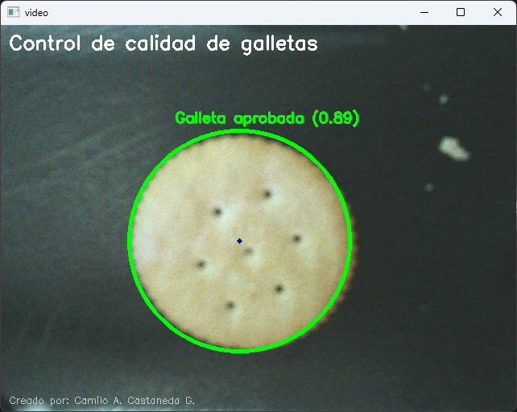
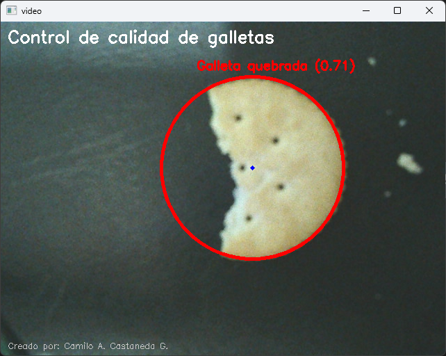
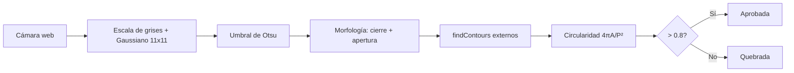

# Control de Calidad de Galletas mediante Visión Artificial


Sistema de **visión por computador en tiempo real** que clasifica galletas como **aprobadas** o **quebradas** a partir de la señal de la cámara web, usando técnicas clásicas de procesamiento de imágenes con **OpenCV**.

> Proyecto académico — Universidad de La Salle, Maestría en Inteligencia Artificial.
> Fundamentos de Inteligencia Artificial, Actividad 8.
> **Autor:** Camilo Andrés Castañeda Galindo

---

## Vista previa

| Galleta aprobada (circularidad 0.89) | Galleta quebrada (circularidad 0.71) |
|:---:|:---:|
|  |  |

---

## Resumen

El sistema detecta la silueta de cada galleta y calcula su **circularidad**. Una galleta entera tiene una forma cercana a un círculo perfecto; una galleta con fragmentos faltantes reduce notablemente esta métrica.

$$\text{Circularidad} = \frac{4\pi \cdot A}{P^2}$$

donde $A$ es el área del contorno y $P$ su perímetro.

| Circularidad | Clasificación | Color |
|:---:|:---:|:---:|
| > 0.8 | Galleta aprobada | Verde |
| 0.5 – 0.8 | Galleta quebrada | Rojo |

## Pipeline



| Etapa | Técnica | Propósito |
|:---|:---|:---|
| Preprocesamiento | Escala de grises + Gaussiano 11×11 | Reducir ruido y simplificar |
| Segmentación | Umbralización de Otsu | Separar galleta del fondo |
| Morfología | Cierre (3 iteraciones) + Apertura (1 iteración) | Rellenar huecos, eliminar ruido |
| Detección | `findContours` externos | Localizar silueta de cada galleta |
| Clasificación | Circularidad (4πA/P²) | Determinar si está entera o quebrada |

---

## Estructura del repositorio

```
├── Actividad_8.ipynb       # Notebook con la implementación
├── Actividad_8.md          # Informe de la actividad
├── galleta_aprobada.png    # Resultado de referencia (aprobada)
├── galleta_quebrada.png    # Resultado de referencia (quebrada)
└── README.md
```

## Requisitos

- Python 3.x
- Cámara web

```bash
pip install opencv-python numpy
```

## Uso

1. Abrir [Actividad_8.ipynb](Actividad_8.ipynb) en Jupyter o VS Code.
2. Ejecutar la celda de código: se abrirá una ventana con la señal de la cámara.
3. Colocar una galleta frente a la cámara, preferiblemente sobre un fondo contrastante y uniforme.
4. Presionar **`q`** para salir.

---

## Conclusiones

- La visión por computador es una de las técnicas de IA más ampliamente implementadas en Python; con OpenCV su implementación es relativamente sencilla para proyectos básicos.
- Permite aplicaciones en tiempo real que apoyan tareas de validación rápida, como el control de calidad de productos o la vigilancia de procesos industriales.
- Aunque OpenCV ofrece muchas funcionalidades, es necesario ajustar los parámetros (umbral, kernel, área mínima, límites de circularidad) para evitar falsos positivos y falsos negativos.

## Referencias

- Iacono, M. (2021, marzo 22). *Computer vision con Python y OpenCV* [Video]. YouTube. https://www.youtube.com/watch?v=ua25vHwca0E
- Google Cloud Tech. (2018, abril 19). *How computer vision works* [Video]. YouTube. https://www.youtube.com/watch?v=OcycT1Jwsns
- Datademia. (2021, noviembre 28). *¿Qué es machine learning?* [Video]. YouTube. https://www.youtube.com/watch?v=EDfI9K9egFc
- Heaton, J. (2022, mayo 25). *Applications of deep neural networks for Keras* [Video]. YouTube. https://www.youtube.com/watch?v=y9cQOMGiGek
- IAAR. (s. f.). *Pasos para construir un modelo de machine learning*. https://iaarbook.github.io/ML/#pasos-para-construir-un-modelo-de-machine-learning
